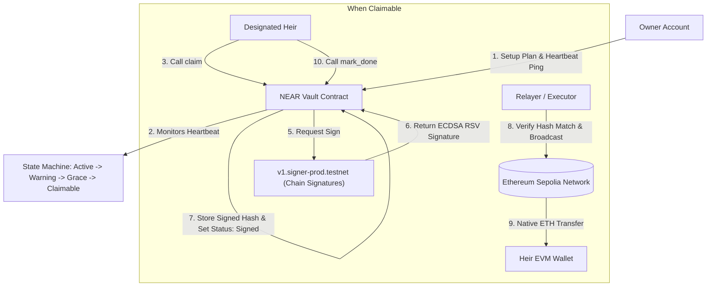

# NEAR + Ethereum Sepolia Inheritance Vault (Dead Man's Switch)

An end-to-end decentralized Dead Man's Switch and inheritance protocol implemented on **NEAR Protocol** controlling **Ethereum Sepolia** native funds using NEAR **Chain Signatures (MPC)**.

---

## 🏛️ Architecture Overview

The system uses a smart contract deployed on NEAR testnet (`vault-heirvault01.testnet`) that acts as a decentralized custodian. Instead of holding Ethereum private keys in custody, the vault controls an Ethereum Sepolia address derived deterministically via NEAR's Multi-Party Computation (MPC) contract `v1.signer-prod.testnet`.



---

## 🔑 Deployed Contracts & Testnet Accounts

| Entity | Address / Identifier | Network | Notes |
|---|---|---|---|
| **Vault Contract** | `vault-heirvault01.testnet` | NEAR Testnet | [View on Explorer](https://explorer.testnet.near.org/accounts/vault-heirvault01.testnet) |
| **Owner Account** | `owner-heirvault01.testnet` | NEAR Testnet | Authorized to `ping` or `setup` |
| **Heir 1** | `heir1-heirvault01.testnet` | NEAR Testnet | 50% Share (`0x5E7e7e39252a159e64a92161f99290E2bFDc42ee`) |
| **Heir 2** | `heir2-heirvault01.testnet` | NEAR Testnet | 50% Share (`0x8AFd2Ad161ff90424eD62A43f6dF6905d96a423d`) |
| **MPC Signer Contract** | `v1.signer-prod.testnet` | NEAR Testnet | Root Key: `secp256k1:4NfTiv3...` |
| **Vault EVM Address** | `0xDAe49575b025e1f21b3238605fE1887c97da210a` | Sepolia | Path: `ethereum-1` (Deterministic MPC) |

---

## ⚙️ State Machine Specification

The vault contract transitions through four distinct states based on elapsed time since the owner's last heartbeat ping:

1. **Active**: `time_elapsed < heartbeat_interval * 0.75` (Normal operation, all timers healthy).
2. **Warning**: `time_elapsed >= heartbeat_interval * 0.75 && time_elapsed < heartbeat_interval` (Owner is approaching expiration).
3. **Grace Period**: `time_elapsed >= heartbeat_interval && time_elapsed < (heartbeat_interval + grace_period)` (Dead man's switch triggered; owner can still avert execution by calling `ping()`).
4. **Claimable**: `time_elapsed >= (heartbeat_interval + grace_period)` (Vault is permanently unlockable; heir slots can be claimed and broadcasted).

---

## 🛡️ Security & Attack Test Results (Recorded Live on Testnet)

All safety checks and invariants were verified on the live NEAR testnet deployment:

| # | Test Scenario | Expected Outcome | Live Test Result |
|---|---|---|---|
| 1 | **Non-owner calls `ping`** | Rejected | ✅ **PASSED**: Panicked with `Only owner can call this method` |
| 2 | **Early claim during `Grace` or `Active`** | Rejected | ✅ **PASSED**: Panicked with `Vault is not claimable yet: must pass grace period` |
| 3 | **Non-heir calls `claim`** | Rejected | ✅ **PASSED**: Panicked with `Only the designated heir can claim this slot` |
| 4 | **Claim of another heir's slot** | Rejected | ✅ **PASSED**: Panicked with `Only the designated heir can claim this slot` |
| 5 | **Claim of an already `Done` slot** | Rejected | ✅ **PASSED**: Panicked with `Slot is already Done` |
| 6 | **Setup after `Grace` starts** | Rejected | ✅ **PASSED**: Panicked with `Setup is blocked during Grace or Claimable state` |
| 7 | **Setup after a claim has started** | Rejected | ✅ **PASSED**: Panicked with `Setup is blocked during Grace or Claimable state` / `Setup is blocked once any heir slot distribution has started` |
| 8 | **Fee above absolute cap (> 0.002 ETH)** | Rejected | ✅ **PASSED**: Panicked with `Estimated fee exceeds absolute fee cap (0.002 ETH)` |
| 9 | **Fee above percentage cap (> 5% of share)** | Rejected | ✅ **PASSED**: Panicked with `Estimated fee exceeds 5% of the heir's share` |
| 10 | **Claim with extra `tx_payload` parameter** | Rejected | ✅ **PASSED**: Denied unknown field at deserialization time |
| 11 | **Unit Test: EIP-2930 Serialization & Hash** | Validated | ✅ **PASSED**: Target Keccak256 hash `e88cf8dc...` verified |

---

## 🚀 Running the Project

### 1. Check Status
```bash
near contract call-function as-read-only vault-heirvault01.testnet status json-args '{}' network-config testnet now
```

### 2. Owner Ping
```bash
near contract call-function as-transaction vault-heirvault01.testnet ping json-args '{}' prepaid-gas '100.0 Tgas' attached-deposit '0 NEAR' sign-as owner-heirvault01.testnet network-config testnet sign-with-keychain send
```

### 3. Run Automated Claim & Relayer
```bash
cd near-multichain
node -e "
import('./orchestrator.mjs').then(async m => {
  const res = await m.processSlot(0);
  await m.broadcastAndMarkDone(res);
});
"
```

### 4. Launch 3-Screen Frontend
Open `frontend/index.html` directly in your browser or serve with:
```bash
npx serve frontend
```

---

## 📋 Verified On-Chain Transactions (Equal 50/50 Distribution)

### NEAR Testnet
- **Deploy Contract**: [`8z3roTeBdcZHSbyJ6KSBSrdjk7LhNXyoxjJD235CdnYf`](https://explorer.testnet.near.org/transactions/8z3roTeBdcZHSbyJ6KSBSrdjk7LhNXyoxjJD235CdnYf)
- **Init Call (`new`)**: [`12m9oRt3xfviondHNeMLtuPUYaDSHaKsTMTku4V2Yeei`](https://explorer.testnet.near.org/transactions/12m9oRt3xfviondHNeMLtuPUYaDSHaKsTMTku4V2Yeei)
- **Setup Plan (`setup`)**: [`Gga3erJ9w1KWrC8f1SybhxtivKGYSXyZG1M4kfF7RyiR`](https://explorer.testnet.near.org/transactions/Gga3erJ9w1KWrC8f1SybhxtivKGYSXyZG1M4kfF7RyiR)
- **Heir 1 Claim Slot #0**: [`5Yf3erRB88MWpgFCRpCYtZ5SHC4yeKDA1dcNwhvDWHAR`](https://explorer.testnet.near.org/transactions/5Yf3erRB88MWpgFCRpCYtZ5SHC4yeKDA1dcNwhvDWHAR)
- **Heir 1 Mark Done**: [`7hTxj2dKzA5hSM9nLHXbfAGvXRZgPjkGarZZUPBwg3J4`](https://explorer.testnet.near.org/transactions/7hTxj2dKzA5hSM9nLHXbfAGvXRZgPjkGarZZUPBwg3J4)
- **Heir 2 Claim Slot #1**: [`5WM4GRy95DzrMJyWkS345q7VGBWCiwz385EiTJQCs276`](https://explorer.testnet.near.org/transactions/5WM4GRy95DzrMJyWkS345q7VGBWCiwz385EiTJQCs276)
- **Heir 2 Mark Done**: [`Bp9e7H4eKG2ce8NESdzZsWwwK1UoSMkAsHjmpniJxsmH`](https://explorer.testnet.near.org/transactions/Bp9e7H4eKG2ce8NESdzZsWwwK1UoSMkAsHjmpniJxsmH)

### Ethereum Sepolia Native Transfers
- **Vault Address**: [`0xDAe49575b025e1f21b3238605fE1887c97da210a`](https://sepolia.etherscan.io/address/0xDAe49575b025e1f21b3238605fE1887c97da210a)
- **Heir 1 Wallet**: [`0x5E7e7e39252a159e64a92161f99290E2bFDc42ee`](https://sepolia.etherscan.io/address/0x5E7e7e39252a159e64a92161f99290E2bFDc42ee)
- **Heir 2 Wallet**: [`0x8AFd2Ad161ff90424eD62A43f6dF6905d96a423d`](https://sepolia.etherscan.io/address/0x8AFd2Ad161ff90424eD62A43f6dF6905d96a423d)
- **Slot #0 Broadcast (0.00649348 ETH)**: [`0x1b900dd011a0f26efe3fd08754cd732045610abd13b8b0c920aa5ed499c06dc4`](https://sepolia.etherscan.io/tx/0x1b900dd011a0f26efe3fd08754cd732045610abd13b8b0c920aa5ed499c06dc4)
  - Block: `#12029758`
  - Status: `1` (SUCCESS)
  - Gas Limit: `250,000`
- **Slot #1 Broadcast (0.00649348 ETH)**: [`0xe72a44753d91f7c92a7d1ee8f9900c9eca49f4044be4d31723035965c54f0d87`](https://sepolia.etherscan.io/tx/0xe72a44753d91f7c92a7d1ee8f9900c9eca49f4044be4d31723035965c54f0d87)
  - Block: `#12029773`
  - Status: `1` (SUCCESS)
  - Gas Limit: `250,000`
- **Total Transferred**: **0.01298696 ETH** delivered equally (50/50 split down to the exact wei) from initial snapshot balance.
